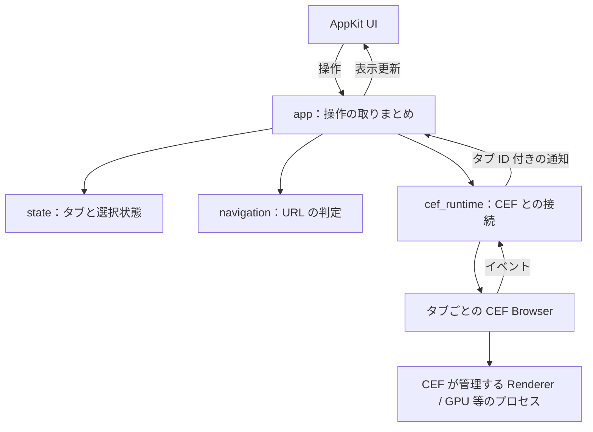

# 概要設計

[README](../README.md) の要求を実現するための初期設計。
以下を実装の出発点とし、試作で制約が分かった場合は理由とともに更新する。動作検証はこれから行う。

## 採用構成

| 項目 | 方針 |
| --- | --- |
| 対象環境 | macOS 26 以降。最初の検証は手元の Apple Silicon Mac で行う |
| アプリの実装 | Rust。AppKit は `objc2` / `objc2-app-kit` 経由で操作する |
| ブラウザ UI | AppKit のウィンドウ・入力欄・ボタン・タブ表示 |
| Liquid Glass | AppKit の `NSGlassEffectView` を操作 UI の一部に使う |
| ページ表示 | `cef-rs` 経由の CEF。Alloy style のネイティブ子 `NSView` として埋め込む |
| 実行形式 | メインアプリ、CEF framework、CEF 用 Helper アプリを含む `.app` |

AppKit と CEF を Rust で直接扱い、タブや操作の状態管理も Rust にまとめる。
CEF はネイティブ UI への埋め込みに対応しており、macOS では Helper アプリが必要になる。
根拠：[CEF の構成](https://chromiumembedded.github.io/cef/tutorial)、[cef-rs](https://github.com/tauri-apps/cef-rs)、[Liquid Glass API](https://developer.apple.com/documentation/appkit/nsglasseffectview)。

## 画面と全体構成

1 つのウィンドウを、上部のタブ・ツールバーと、下部のページ表示領域に分ける。
上部に URL 入力、戻る・進む・再読み込み、タブの追加・選択・終了を配置する。
ページ領域は不透明にし、選択中のタブだけを表示する。初期実装は上下に分割し、Glass の重ね合わせは後で検証する。

タブと CEF Browser は 1 対 1 にする。CEF の子プロセス数・割り当ては CEF が管理し、1 タブ 1 プロセスとは仮定しない。

## 役割と状態の所有者

最初は 1 つの Cargo パッケージ内で、次のモジュールに分ける。

| モジュール | 所有するもの・責務 |
| --- | --- |
| `app` | 起動・終了、操作とイベントの振り分け、各モジュールの接続 |
| `state` | タブの順序、選択中の `TabId`、タブごとの表示情報と生成・終了状態 |
| `platform/macos` | AppKit のウィンドウ、View、入力・フォーカス、UI 更新 |
| `cef_runtime` | CEF 初期化、Browser の参照、CEF Browser ID と `TabId` の対応、コールバック |
| `navigation` | URL の解析と遷移を許可するかの判定。AppKit / CEF に依存させない |

- `TabId` はアプリが発行し、実行中に再利用しない。配列の位置を ID にしない。
- `state` は URL・タイトル・読み込み状態・エラー・戻る／進むの可否を持つ。CEF の参照や生ポインタを持たない。
- ページと閲覧履歴の正本は CEF Browser が持つ。Rust 側に別の履歴スタックを作らない。
- URL 入力欄の編集中の文字列は、CEF が通知した現在の URL と分けて保持する。
- AppKit / CEF の FFI と `unsafe` は、それぞれの接続用モジュールに閉じ込める。

## 操作とイベントの流れ

1. UI は操作対象の `TabId` を付けて `app` に操作を渡す。
2. `app` はタブの存在・操作可能な状態と URL 方針を確認し、`cef_runtime` に操作を依頼する。
3. CEF の通知を `TabId` と CEF Browser ID に結びつけ、`app` が対象タブの状態を更新する。
4. UI は更新後の状態を表示する。選択していないタブの通知も、そのタブだけに反映する。

UI・タブ状態の変更・CEF の UI 操作はメインスレッドに集約する。
イベントループは公式 macOS 例に沿う `cef::run_message_loop()` に一本化し、CEF に必要なプロトコルを実装した `NSApplication` を使う。
他スレッドのコールバックから UI を直接変更しない。CEF 呼び出し中に可変状態の借用を保持せず、再入や通知の処理を整理する。
根拠：[cef-rs の macOS 実装例](https://github.com/tauri-apps/cef-rs/blob/dev/examples/cefsimple/src/mac/mod.rs)。

読み込み中・戻る／進むの可否は `OnLoadingStateChange`、URL は主フレームの `OnAddressChange`、タイトルは `OnTitleChange` から反映する。
主フレームの読み込み失敗はネイティブ UI に表示し、遷移の中断を表す `ERR_ABORTED` は失敗として表示しない。
閉じた Browser の通知は無視する。CEF のロード通知には遷移 ID がないため、独自の連番を付けるだけで古い遷移を識別できるとは仮定しない。
連続遷移時の通知と現在の CEF 状態の照合は、最初のナビゲーション実装で確認する。
根拠：[ロード通知](https://github.com/chromiumembedded/cef/blob/master/include/cef_load_handler.h)、[表示通知](https://github.com/chromiumembedded/cef/blob/master/include/cef_display_handler.h)。

## タブの生成・切り替え・終了

- 起動時と新規タブは空白表示にする。URL を確定してから外部ページへ移動する。
- Browser の生成は非同期に扱い、`OnAfterCreated` で操作可能にする。生成前に届いた終了要求も保持し、生成後に閉じる。生成要求が失敗した場合は待機状態を解消し、UI に失敗を反映する。
- 切り替えでは View の表示とフォーカスを移す。Browser を作り直さず、ページと履歴を維持する。
- 終了要求では `CloseBrowser(false)` を呼び、ページの終了確認が取り消された場合はタブを維持する。`DoClose` 到着後に終了処理へ進める。
- タブ単位の終了では、対象の CEF 子 View だけを破棄する経路を実装する。既定の終了通知で共有の親ウィンドウを閉じないようにする。
- `OnBeforeClose` で Browser の参照・対応表・タブを解放する。選択中タブを閉じたら右隣、なければ左隣を選ぶ。
- 最後のタブを閉じたらウィンドウを閉じ、アプリを終了する。ウィンドウを閉じる操作やアプリ終了も、全 Browser の終了手順に合流させる。
- 全 Browser の `OnBeforeClose` を待ってループを停止し、ループから戻った後に CEF を終了する。生成待ちの Browser もこの対象に含める。

子 View の所有権と非同期終了は、最初の試作で確認する。
根拠：[CEF の寿命管理](https://github.com/chromiumembedded/cef/blob/master/include/cef_life_span_handler.h)、[macOS の View 終了処理](https://github.com/chromiumembedded/cef/blob/master/libcef/browser/native/browser_platform_delegate_native_mac.mm)。

## 遷移と外部ページの境界

- ブラウザ UI はネイティブ View として作り、外部ページにアプリ操作用の JavaScript ブリッジ・特権 IPC を公開しない。
- 閲覧対象のトップレベル遷移は HTTP / HTTPS のみ。入力、リンク、リダイレクトに同じ URL 判定を使い、CEF 側の遷移前コールバックでも判定する。トップレベルの内部空白表示はアプリ側だけの例外とする。
- `file:`、CEF 内部 URL、外部プロトコルへの遷移禁止はサブフレームにも適用する。サブフレーム内の通常の `about:blank`・`data:`・`blob:` 利用は CEF のセキュリティに従う。
- `javascript:` は URL 入力・トップレベル遷移先として受け付けない。ページ内の通常の JavaScript 実行は CEF に任せる。
- 外部アプリ起動は `OnProtocolExecution` でも拒否する。この判定はコールバックのスレッド上で行い、UI を変更しない。
- MVP ではページ起点の新規ウィンドウ・新規タブ要求を拒否する。タブはブラウザ UI から作成する。この制約は動作確認時に記録する。
- HTTP / HTTPS 制限を画像などのサブリソースに一律適用しない。CEF の通常の Web セキュリティを維持する。
- Chromium sandbox と証明書検証を有効にする。Helper は CEF framework をロードする前に sandbox を初期化する。

根拠：[遷移のフック](https://github.com/chromiumembedded/cef/blob/master/include/cef_request_handler.h)、[外部プロトコルのフック](https://github.com/chromiumembedded/cef/blob/master/include/cef_resource_request_handler.h)、[sandbox の要件](https://github.com/chromiumembedded/cef/blob/master/docs/sandbox_setup.md)。

## 保存の範囲

MVP は全タブでメモリ内の RequestContext を共有し、Cookie などのログイン状態は終了時に失われる構成にする。
タブごとの閲覧履歴は別々に維持するが、ログイン状態をタブごとに隔離する設計にはしない。
CEF のインストール用データには suiren 専用の `root_cache_path` を指定する。アプリ独自の DB やセッション復元は作らない。
根拠：[CEF のキャッシュ設定](https://github.com/chromiumembedded/cef/blob/master/include/internal/cef_types.h)。

## 実装順と確認すること

1. Rust + CEF で `.app` を起動する。外部 HTTPS ページ表示、Helper / sandbox、正常終了を確認する。
2. AppKit の操作 UI と Liquid Glass を組み合わせる。リサイズ、日本語入力、フォーカス移動を確認する。
3. URL 入力とナビゲーションを実装し、不正 URL、通信失敗、連続遷移と遷移制限を確認する。
4. 複数タブを実装し、状態と履歴の独立、生成・読み込み中の終了、終了の取り消し、最後のタブの終了を確認する。

`state` と `navigation` の独立したロジックは単体テストし、AppKit / CEF の連携は実機で確認する。
依存ライブラリと CEF のバージョンは実装開始時に対応を確認して固定し、起動手順と検証結果を残す。
UI の寸法・配色、URL 補完などの細かな操作仕様は、それぞれを実装する段階で決める。
